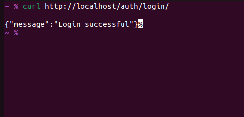
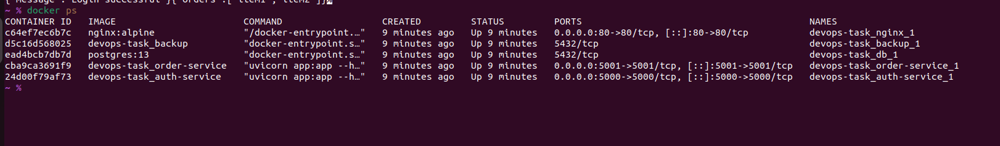

# Dockerized FastAPI Microservices with Nginx, PostgreSQL, and Automated Backups

This project is a full-stack DevOps setup that demonstrates a production-ready microservices architecture using Docker, FastAPI, Nginx as a reverse proxy, PostgreSQL as a persistent database, and cron-based automated database backups.

---

## Project Structure
devops-task/
├── auth-service/ # FastAPI service for authentication
├── order-service/ # FastAPI service for orders
├── nginx/ # Nginx reverse proxy configuration
├── db/ # DB initialization SQL script
├── backup/ # Backup script, crontab, Dockerfile
├── docker-compose.yml # Orchestration of all services
└── README.md # Project documentation

## API Endpoints

| Service        | Route                         | Description         |
|----------------|-------------------------------|---------------------|
| Auth Service   | `GET /auth/login/`            | Test login route    |
| Order Service  | `GET /orders/`                | Sample orders list  |
| Swagger Docs   | `/docs` (on each service port)| Auto-generated docs |

> Note: Endpoints are accessed via **Nginx (port 80)**

### 🔹 Order Service Response


###  Example Usage

```bash
curl http://localhost/auth/login/
curl http://localhost/orders/

---
### 🔹 Auth Service Response


### 🔹 Order Service Response


## Technologies Used

- Python 3.10
- FastAPI
- Docker & Docker Compose
- PostgreSQL
- Nginx (Reverse Proxy)
- Cron (for scheduled backups)
- Bash scripting

---

## How to Run the Project

### Prerequisites
- Docker
- Docker Compose

### 🔹 Running Docker Containers

### Setup Instructions

```bash
git clone <your-repo-url>
cd devops-task
docker-compose up --build

## 🛢️ PostgreSQL Database

- **Host**: `db` (internal Docker network alias)
- **Port**: `5432`
- **Database**: `microdb`
- **Username**: `user`
- **Password**: `password`

---

### Tables Created (via `init.sql`)

```sql
CREATE TABLE IF NOT EXISTS users (
    id SERIAL PRIMARY KEY,
    username VARCHAR(50)
);


##  Automated Database Backups

- Backup runs **every 1 minute** via `cron` in the `backup` container.
- Script used: `backup.sh`
- Location: Stored in `/backups` as compressed `.sql.gz` files.

---

###  Cron Job Config (`crontab.txt`)

```cron
*/1 * * * * /bin/bash /backups/backup.sh >> /var/log/backup.log 2>&1
